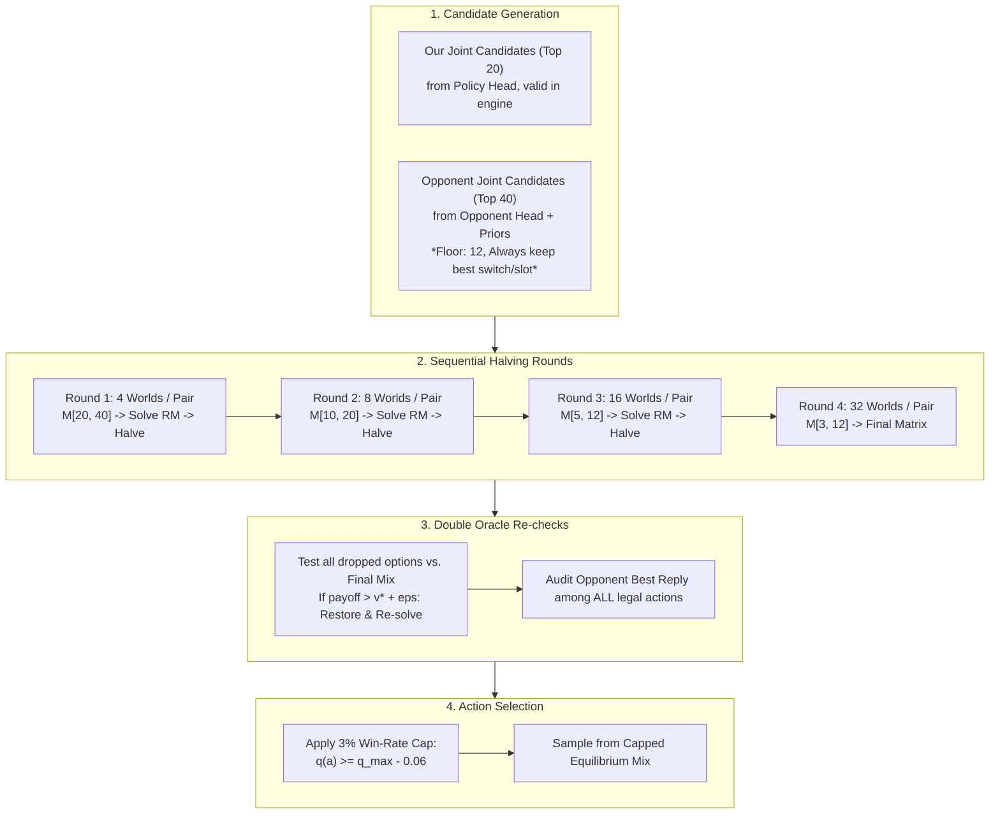
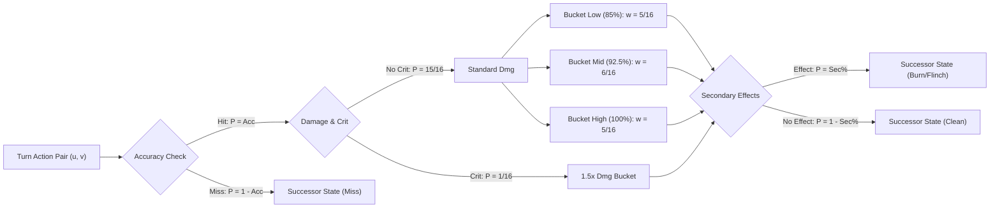
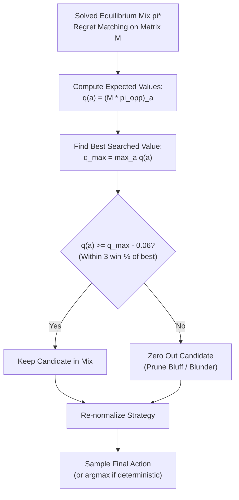

# VGC Search Engine Architecture: Chance Branching, Sequential Halving & Double Oracle

## 1. Executive Summary

This document specifies the architecture and implementation of the simultaneous-move lookahead search engine for competitive Pokémon VGC (Gen 9 Champions Reg MC / Reg H). The system replaces traditional Monte Carlo random seed averaging with **analytical chance event branching** and replaces uniform Cartesian exploration with **sequential halving** and **Double Oracle re-checks**.

### Core Philosophy
1. **Zero Simulator Variance on Chance Events:** Dice rolls (damage rolls, critical hits, accuracy, secondary status/flinch, speed ties) are enumerated analytically with their exact probabilities rather than sampled.
2. **Sequential Halving of Candidates:** Candidate space begins wide (our top 20 joint actions vs. their top 40) and is halved across iterative rounds, with world allocations escalating ($4 \to 8 \to 16 \to 32$) as the candidate pool contracts ($20 \to 10 \to 5 \to 3$).
3. **Double Oracle Equilibrium Verification:** Dropped candidate actions are audited against the final equilibrium mix; any dropped action that beats the equilibrium is restored and re-solved.
4. **Win-Rate Bounded Action Selection:** Final action selection samples from the equilibrium mixed strategy but strictly caps out any move with expected value more than 3 win-% points ($\Delta V = 0.06$ in $[-1, 1]$ payoff scale) below the best searched value.

---

## 2. Depth 1: Simultaneous Lookahead & Sequential Halving

Pokémon VGC is a 2v2 simultaneous-move game. Each player submits a joint action $(a_0, a_1)$ where each slot chooses a move, target, or switch.



### A. Candidate Generation
- **Our Candidates ($K=20$):**
  - Top 20 joint action pairs $(a_0, a_1)$ from the policy head, filtered to valid engine actions.
  - Floor constraint: Never fewer than 2 candidates.
- **Opponent Candidates ($M=40$):**
  - Top 40 joint actions from the neural net's opponent prediction head (`opp_a`, `opp_b`), conditioned per slot and corrected by historical match priors.
  - Floor constraint: Never cut below 12 candidates.
  - **Switch Preservation Invariant:** The search engine must **always** include the opponent's single most likely switch-out option for slot 0 (`action in (16, 17)`) and slot 1 (`action in (16, 17)`). This prevents the bot from walking into free switches or surprise pivots.

### B. Sequential Halving Rounds
Rather than evaluating all $20 \times 40 = 800$ pairs across deep world sets, search uses progressive candidate elimination:

| Round | Worlds / Pair | Our Candidates ($U$) | Opponent Candidates ($V$) | Active Cells |
| :---: | :---: | :---: | :---: | :---: |
| **Round 1** | 4 worlds | Top 20 | Top 40 | $\le 800$ |
| **Round 2** | 8 worlds | Top 10 | Top 20 | $\le 200$ |
| **Round 3** | 16 worlds | Top 5 | Top 12 (floor) | $\le 60$ |
| **Round 4** | 32 worlds | Top 3 (floor 2) | Top 12 (floor) | $\le 36$ |

- **Equilibrium Solving:** Each round solves the zero-sum normal-form subgame $M_{U, V}$ using Regret Matching:
  $$q_u = (M_{U, V} \cdot \pi_V)_u, \quad q_v = - (\pi_U^T \cdot M_{U, V})_v$$
- **Pruning Criterion:** The weaker half of each player's candidate set is dropped based on marginal payoff against the opponent's current equilibrium strategy.

### C. Double Oracle Re-Checks
Sequential halving aggressively cuts candidates early. To guarantee soundness against non-monotonic game dynamics:
1. **Dropped Candidate Audit:** Any action $u \notin U$ dropped during halving is tested against the final equilibrium strategy $\pi_V^*$:
   $$\text{Payoff}(u) = \sum_{v \in V} \pi_V^*(v) \cdot M[u, v]$$
   If $\text{Payoff}(u) > v^* + \epsilon$ (where $v^*$ is the game value and $\epsilon = 0.01$), candidate $u$ is restored to $U$.
2. **Opponent Exploit Audit:** Any dropped opponent response $v \notin V$ is tested against $\pi_U^*$:
   $$\text{Payoff}_{\text{opp}}(v) = - \sum_{u \in U} \pi_U^*(u) \cdot M[u, v]$$
   If $\text{Payoff}_{\text{opp}}(v) > -v^* + \epsilon$, candidate $v$ is restored to $V$.
3. **Full Legal Best Reply:** An extra verification step tests the opponent's best response across **all legal joint actions** in the game state. If an unconsidered line exploits the equilibrium, it is added and the matrix is re-solved.

---

## 3. Exact Chance Branching vs. Simulator Seeds

### A. The Flaw of Monte Carlo Seed Sampling
In standard Monte Carlo search, a game engine steps each action pair using a random seed. This introduces two fatal flaws in Pokémon VGC:
1. **High-Impact, Low-Probability Events:** A 6.25% critical hit (or 10% Freeze / 30% Flinch) that secures a knockout is either completely missed (0 out of 16 seeds) or over-represented (2 out of 16 seeds = 12.5%), distorting the payoff matrix.
2. **Luck Correlation:** Random seeds introduce sample noise between candidate columns, causing the LP/Regret Matching solver to select noisy, suboptimal lines.

### B. Analytical Chance Enumeration
In native Rust (`vgc_engine.multi_world_rollout_chance` / `vgc_solver::enumerate_outcomes_bounded`), chance events are decomposed analytically into exact branch probabilities:



1. **3-Bucket Damage Collapse:**
   - Gen 9 damage rolls span 16 discrete integers from 85% to 100% of maximum damage.
   - The engine collapses these into 3 weighted representative buckets:
     $$\text{Weights: } \left[\frac{5}{16}, \frac{6}{16}, \frac{5}{16}\right] \implies \mathbb{E}[\text{damage}] \text{ is exactly preserved.}$$
   - When a KO threshold splits the damage roll (e.g. 4 rolls KO, 12 do not), the engine splits the node into exact KO and non-KO probabilities.
2. **Critical Hits:**
   - Standard moves: $P(\text{crit}) = \frac{1}{16}$, $P(\text{no crit}) = \frac{15}{16}$ (1.5× damage multiplier).
   - High-crit moves: $P(\text{crit}) = \frac{1}{8}$, $P(\text{no crit}) = \frac{7}{8}$.
3. **Accuracy / Evasion:**
   - Multipliers calculated through accuracy and evasion stages ($-6 \dots +6$).
4. **Secondary Effects:**
   - Burn, paralysis, freeze, flinch, and stat drops branched according to move data.
5. **Speed Ties & Replacements:**
   - Same-speed actions branch 50/50.
   - Simultaneous double KOs trigger mid-turn replacement subgames solved as mini-matrix games rather than arbitrary coin flips.

### C. Mathematical Payoff Computation
For every candidate cell $(i, j)$:
$$M[i, j] = \sum_{k=1}^{B_{ij}} P(k) \cdot V(s_k)$$
where:
- $\sum_{k=1}^{B_{ij}} P(k) = 1.0$ strictly.
- $V(s_k) = +1.0$ if state $s_k$ is a decisive win for our side.
- $V(s_k) = -1.0$ if state $s_k$ is a decisive loss for our side.
- $V(s_k) = 0.0$ if state $s_k$ is a draw.
- $V(s_k) = \tanh(V_{\text{head}}(s_k)) \in [-1.0, 1.0]$ if state $s_k$ is non-terminal, evaluated in batched forward passes through `Transformer19`.

---

## 4. World Modeling: Hidden Information & Dice Allocation

In closed team sheets or partial information states, the opponent's unseen moves, items, abilities, and EV spreads are unknown.

### A. The 8 Set Guesses
Search maintains 8 concrete set worlds:
- **World 0 (MAP / MLE Best Guess):**
  - Inferred from the MunchStats / Smogon usage distribution conditioned on all revealed facts.
  - EVs and natures constrained by observed in-game damage calculations (exact damage rolls seen on previous turns eliminate incompatible spread ranges).
- **Worlds 1–7 (Sampled Posterior Sets):**
  - Drawn from the posterior set distribution consistent with all observed moves, items, and abilities.
- **Fixed Information Invariant:** Any fact that is publicly known (revealed moves, activated items like Booster Energy, revealed abilities like Intimidate, or Open Team Sheets) is strictly fixed across all 8 worlds.

### B. Dice Allocation Across Worlds
Experiments show that spreading chance/dice evaluations across set guesses yields significantly higher win rates than concentrating on a single set guess:
- With 16 rollouts per pair, **8 set guesses $\times$ 2 chance variants** outperformed $1 \times 16$, $2 \times 8$, $4 \times 4$, and $16 \times 1$.
- With exact chance branching, the 8 set worlds capture *epistemic uncertainty* (hidden sets), while the chance tree within each set world captures *aleatoric uncertainty* (dice), combining into a Bayes-Nash equilibrium.

---

## 5. Depth 2: Selective Deepening

To avoid combinatorial explosion, 2-turn lookahead is applied selectively.

### A. Selection Metric: Probability $\times$ Uncertainty
Only the **16 most critical leaf positions** after Turn 1 are deepened:
$$\text{Priority}(s) = P(s) \cdot \text{Uncertainty}(V(s))$$
where:
- $P(s) = \pi_U(u) \cdot \pi_V(v) \cdot P(\text{chance branch})$.
- $\text{Uncertainty}(V) = 1.0 - |V(s)|$ (positions near $V=0.0$ are tightly contested and uncertain; positions near $|V|=1.0$ are decided).

### B. Endgame Exhaustion
When both players have $\le 2$ Pokémon remaining:
- The game tree contracts sharply (no switching choices; only 1 or 2 active attackers).
- In this regime, **every continuation position** is deepened (up to ~200 positions), providing exact endgame resolution.

### C. Information Sets (Imperfect Recall Abstraction)
- Lines are played out across 4 set worlds.
- Positions that appear identical from our perspective (same revealed species, HP fractions, statuses, field conditions) are clustered into a single **Information Set**.
- Our policy must play a **single strategy** across the information set, while the opponent's strategy can condition on their actual private set.
- Candidates at Depth 2: Top 4 ours vs. Top 4 theirs ($4 \times 4$), or $6 \times 6$ in endgames.
- Evaluated leaves feed back via backward induction into the Turn 1 matrix $M$.

---

## 6. Final Action Selection & Win-Rate Cap



### The 3% Win-Rate Cap
In simultaneous-move equilibrium strategies, small probabilities are sometimes assigned to low-EV defensive or bluff options to prevent exploitation. However, in live play against human or bot opponents, playing an action with substantially lower expected value is fragile.

- **Threshold:**
  $$\Delta V = 2 \cdot \Delta W = 2 \times 0.03 = 0.06 \quad (\text{on } [-1.0, +1.0] \text{ scale})$$
- **Rule:** Any action $a$ with:
  $$q(a) < q_{\max} - 0.06$$
  is strictly zeroed out.
- The remaining probabilities are re-normalized:
  $$\pi_{\text{final}}(a) \propto \pi^*(a) \cdot \mathbb{I}[q(a) \ge q_{\max} - 0.06]$$
- If all actions are filtered out (numerical edge case), the bot deterministically chooses $\arg\max_a q(a)$.

---

## 7. Codebase Implementation & File Map

| Component | File Path | Functions / Classes |
| :--- | :--- | :--- |
| **Chance Rollout Engine** | [`crates/vgc-engine-py/src/lib.rs`](file:///home/nisanth/projects/ai-vgc/vgc_engine_repo/crates/vgc-engine-py/src/lib.rs#L4782) | `multi_world_rollout_chance` |
| **Solver Core** | [`crates/vgc-solver/src/lib.rs`](file:///home/nisanth/projects/ai-vgc/vgc_engine_repo/crates/vgc-solver/src/lib.rs#L415) | `enumerate_outcomes_bounded`, `3bucket` |
| **Showdown Search Agent** | [`scripts/eval_showdown_stateful_shadow.py`](file:///home/nisanth/projects/ai-vgc/scripts/eval_showdown_stateful_shadow.py#L731) | `search_turn_19`, `solve_regret_matching` |
| **Hidden World Solvers** | [`src/ai_vgc/nn/double_oracle.py`](file:///home/nisanth/projects/ai-vgc/src/ai_vgc/nn/double_oracle.py#L34) | `solve_hidden_world_regret`, `solve_hidden_world_game` |
| **Search Engine Wrapper** | [`src/ai_vgc/nn/rust_search.py`](file:///home/nisanth/projects/ai-vgc/src/ai_vgc/nn/rust_search.py#L220) | `rust_search`, `filter_opponent_candidates` |
| **Unit Test Suite** | [`tests/test_chance_branching_search.py`](file:///home/nisanth/projects/ai-vgc/tests/test_chance_branching_search.py#L1) | `test_multi_world_rollout_chance_exact_probabilities`, `test_win_rate_cap` |

---

## 8. Verification & Benchmarking Command

To benchmark Model 19 using the chance-branching search engine against `v7f-MC378` or `v6` on Showdown:

```bash
uv run python scripts/eval_showdown_stateful_shadow.py \
    --model-path data/models/model19_best_1054m_ema.pt \
    --opp-model data/models/mc-cts-rnad-v7f-MC378.pt \
    --opp-team MC378 \
    --belief-priors data/public-priors.json \
    --search \
    --depth 1 \
    --search-k 20 \
    --search-m 40 \
    --games 50
```
